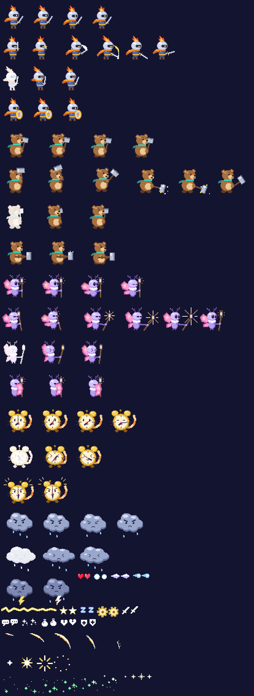

# Fight Creator

Przeglądarkowy edytor i silnik turowych walk z fazą unikania pocisków (bullet box) — w stylu Deltarune,
ale z własnymi, oryginalnymi grafikami, muzyką i postaciami. Działa w przeglądarce, bez instalacji.

> **Stan: Etap 1 — silnik walki i GUI.** Kolejne etapy: edytor walk (Etap 2), zapis w chmurze z kontami
> użytkowników oraz eksport/import `.json` / `.zip` (Etap 3).



## Uruchomienie

```bash
npm install
npm run dev          # serwer deweloperski (http://localhost:5173)
npm run build        # wersja produkcyjna w dist/
npm run build:single # cała gra w jednym pliku dist-single/index.html (działa offline)
npm test             # testy jednostkowe logiki walki
```

## Sterowanie

| Akcja | Klawiatura | Pad |
|---|---|---|
| Ruch / wybór | strzałki | krzyżak, lewa gałka (analogowo) |
| Zatwierdź | `Z`, `Enter` | A |
| Cofnij / wolniejszy ruch serduszka | `X`, `Shift` | B |
| Pauza | `C`, `Ctrl`, `Esc` | X, Y, Start |

Na telefonach pojawiają się przyciski dotykowe (krzyżak + Z/X/C).

## Co działa (Etap 1)

- **Drużyna do 3 postaci** z HP, kolorem, głosem i animacjami (idle, atak, obrażenia, obrona).
- **Menu FIGHT / ACT / MAGIC / ITEM / SPARE / DEFEND** z ikonami, podświetleniem, cofaniem wyboru (X wraca do poprzedniej postaci i zwraca zużyte TP/przedmioty).
- **FIGHT** — minigra z paskiem timingu: kreski kolejnych postaci ruszają jedna po drugiej, trafienie w środek = „IDEALNIE!” i krytyk.
- **ACT** — akcje zdefiniowane per przeciwnik, z tekstami i efektami (+Mercy, obrażenia, leczenie, TP, zmiana zachowania wroga, osłabienie statystyk).
- **TP** — pionowy pasek po lewej; rośnie przy grazingu, DEFEND i trafieniach, zużywany na MAGIC i niektóre ACT.
- **Mercy** — procent przy każdym wrogu; warunki oszczędzenia (Mercy, niskie HP, numer tury, tryb „dowolny”/„wszystkie”).
- **Tura wroga** — bullet box (prostokąt lub elipsa, rozmiar per atak), serduszko SOUL, i-frames po trafieniu, grazing z poświatą i dźwiękiem.
- **Pociski**: ruch prosto, falą, za graczem (naprowadzanie), po okręgu; serie, wachlarze, pierścienie, powtórzenia, przyspieszenie, losowość, ostrzeżenie przed wystrzałem, celowanie w serduszko.
- **Fazy walki** — zmiana zestawu ataków, kolejności (po kolei / losowo) i muzyki np. przy 50% HP.
- **Dialogi** — tekst pisany literka po literce z „blipem” (inny głos każdej postaci), kolory i efekty w tekście, dymki przy wrogach.
- **Powalenie** postaci przy 0 HP, samodzielne wstawanie po kilku turach albo podniesienie leczeniem.
- **Ekrany wyniku**: zwycięstwo, pokój (wszyscy oszczędzeni), porażka — z podsumowaniem EXP, monet i statystyk.
- **Pauza** (wznów, od nowa, dźwięk), 60 FPS ze stałym krokiem logiki, obraz 640×480 skalowany bez rozmywania.

## Przykładowa walka „Pobudka w deszczu”

Iskra (rycerka z płomiennym pióropuszem), Borek (niedźwiadek z młotem) i Lumi (ćma-czarodziejka) kontra
**Budzikot** (koci budzik) i **Chmurnik** (naburmuszona chmurka). Sześć ataków pokazuje wszystkie wzory ruchu,
druga faza startuje przy 50% łącznego HP wrogów. Walkę można wygrać siłą albo pokojowo — np. „Pogłaszcz”
i „Nakręć” Budzikota, „Żart” i „Pociesz” dla Chmurnika, a potem SPARE.

Muzyka (dwa utwory chiptune z wstępem i pętlą) oraz wszystkie efekty dźwiękowe są syntezowane w kodzie —
gra nie potrzebuje żadnych plików audio. Wbudowane utwory mają ustawione punkty `loopStart` / `loopEnd`.

## Struktura kodu

```
src/
  core/      pętla gry 60 Hz, wejście (klawiatura/pad/dotyk), grafika, font bitmapowy i tekst, ładowanie zasobów
  audio/     silnik Web Audio (muzyka z pętlą, efekty, blipy), syntezator efektów, mini-tracker chiptune
  battle/    silnik walki: types.ts (format projektu), battle.ts (przebieg tur), arena.ts (bullet box),
             patterns.ts (pociski), menu.ts, timing.ts, dialog.ts, hud.ts, fx.ts, formulas.ts, validate.ts,
             sample.ts (przykładowa walka)
  app/       skalowanie obrazu, przyciski dotykowe
  assets/    wygenerowane sprite'y (PNG + manifest) i atlas fontu
tools/       generatory sprite'ów i atlasu fontu (node tools/gen-sprites.mjs, node tools/gen-font.cjs)
tests/       testy jednostkowe (vitest)
```

Cała walka to jeden obiekt JSON (`FightProject` w `src/battle/types.ts`) — ten sam format będzie czytał
edytor, zapis w chmurze i eksport. Każda grafika to spritesheet z rozmiarem klatki, liczbą klatek i prędkością
animacji, więc w Etapie 2 wystarczy podmienić źródło na wgrany plik PNG.

## Licencje zasobów

- Font **Jersey 10** — © 2023 The Soft Type Project Authors, [SIL Open Font License 1.1](https://openfontlicense.org).
- Sprite'y, muzyka i efekty dźwiękowe — oryginalne, wygenerowane kodem w tym repozytorium.
